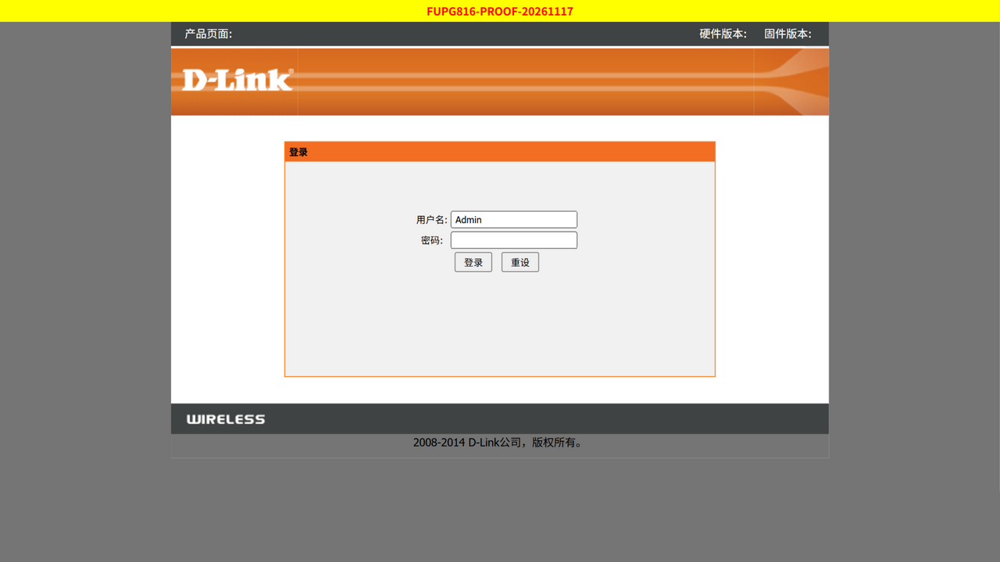
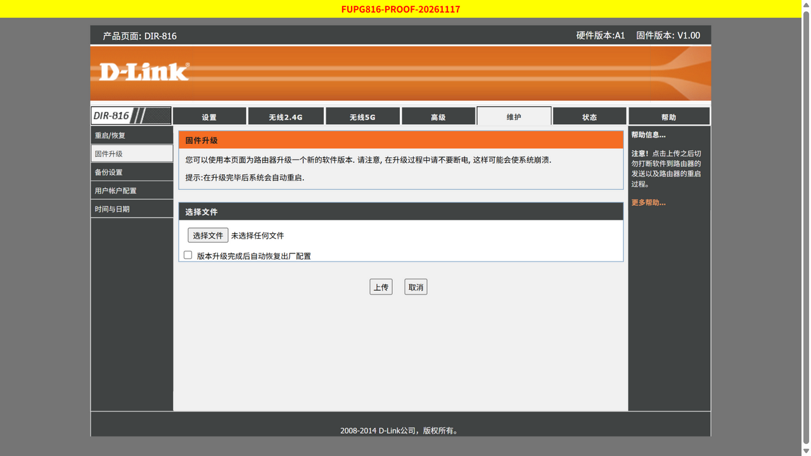
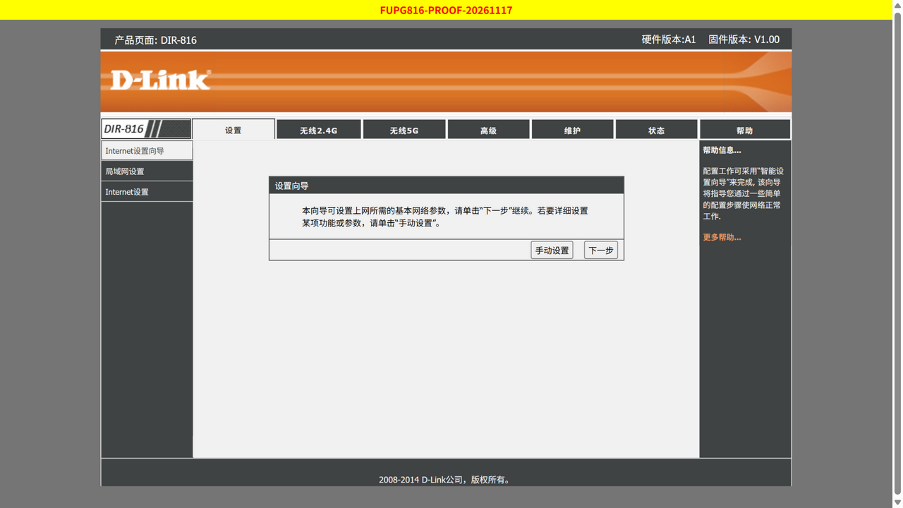
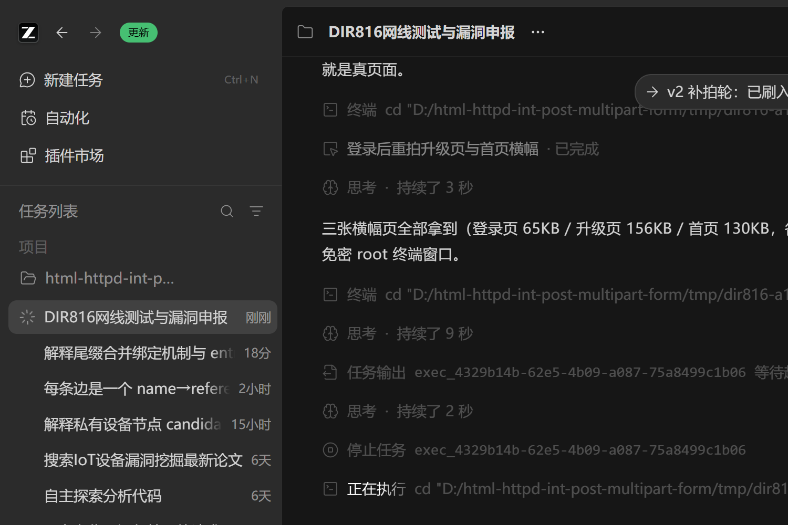
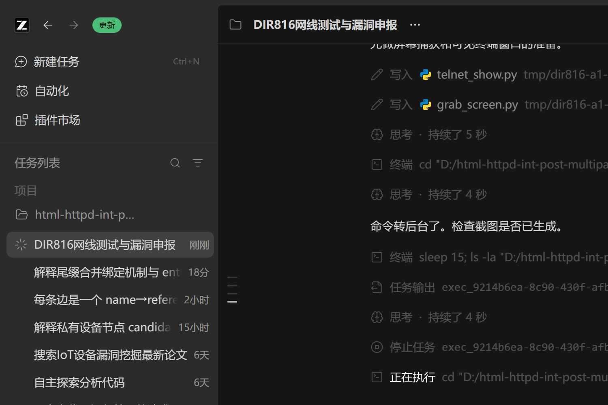
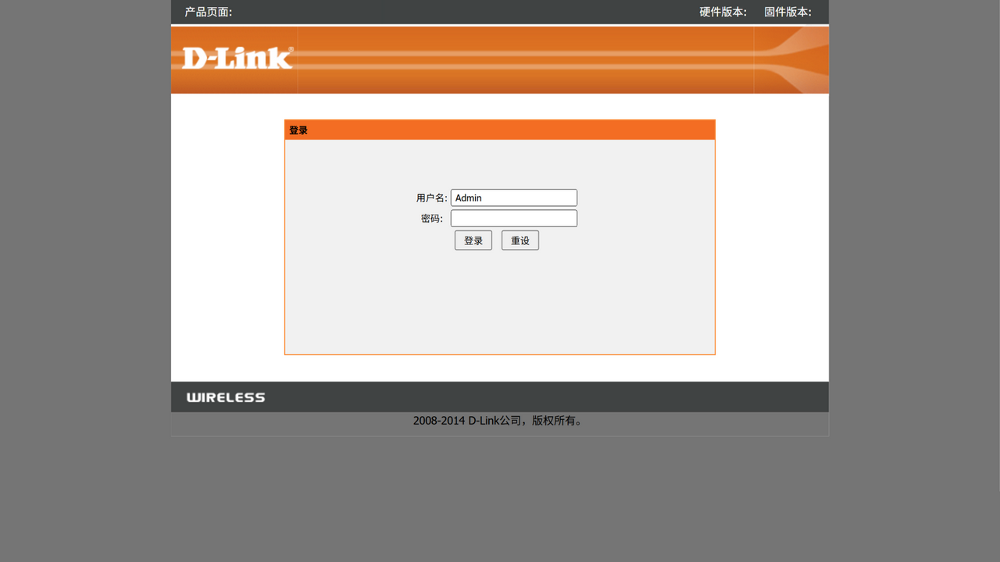

# Vulnerability Report — Missing Firmware Signature Verification in the D-Link DIR-816 A1 Router Enables Persistent Arbitrary Code Execution; Shipped with Default Telnet Root Credentials

## 1. Summary

The web-based firmware upgrade function of the **D-Link DIR-816 (hardware rev. A1, CN firmware v1.01CNB04)**
accepts firmware images **without verifying a digital signature, hash whitelist, version consistency, or any
other proof of authenticity**. The only device-side checks on an uploaded image are a uImage magic-number
check, two CRC32 integrity checks, and a partition-size check — all of which an attacker recomputes trivially.

An attacker on the LAN with any valid web-administrator credentials can upload a modified firmware image.
The device accepts it, writes it to the `Kernel_RootFS` flash partition, reboots, and executes the
attacker-controlled startup scripts. The result is **persistent, root-level arbitrary code execution** that
survives reboots, cannot be removed through the management UI (read-only squashfs rootfs), and is
**indistinguishable from official firmware** through the UI, because the version string is served from NVRAM
and is decoupled from the actually flashed image.

This was **dynamically verified on live hardware**: a self-built, unsigned, same-version repacked image
containing a boot-script change (`telnetd -l /bin/sh`) and injected web-page content passed all device-side
checks, was flashed, and executed on reboot — verified down to a boot-time marker file and the modified
process list. A corrupted-image control was rejected with the exact reverse-engineered error string,
confirming the CRC check is the only gate. The device was subsequently restored to official firmware.

Two related exposures were also live-verified and are reported here together because they change the
real-world severity of the primary finding:

- **(A) Factory-default root access on the LAN:** the stock startup script launches a telnet daemon
  unconditionally ("for telnet debugging"), and the factory-default account `Admin` with an **empty
  password** is valid for both the web interface and telnet, granting an interactive root shell out of the box.
- **(B) Process-global login state:** after any single successful web login, the GoAhead CGI gate
  (`g_login_flag`) admits **all** LAN clients without credentials until the next reboot.

## 2. Affected Products

| Product | Firmware | Verification status |
|---|---|---|
| D-Link DIR-816 **A1** (CN, Ralink MT7620) | `v1.01CNB04` (`DIR816_A1_FW101CNB04.img`, sha256 `32b56ac7ba208a7debbe3fc760f7fe6817386f4112f2b283f6dc4dd9c00ab620`) | **Fully verified on live hardware** (negative control + modified-image upload → flash → execution → restore) |
| D-Link DIR-816 A1 (CN) | other `CNB0x` builds (device under test initially ran an older 2014 build) | Same `upload.cgi` / `check()` code path confirmed statically; default-credential telnet access re-verified on CNB04 after restore |

Note: existing DIR-816 CVEs (e.g., the A2 command-injection/overflow series, CVE-2019-17507 on A1 1.06, and
CVE-2025-46176 on the different US **DIR-816L** product) do not cover firmware-authenticity or the
default-credential telnet exposure on the A1; an NVD keyword sweep on 2026-11-17 found no collision.

## 3. Vulnerability Classification

- **Primary (firmware update) CWE-345** — Insufficient Verification of Data Authenticity
  (related: CWE-347, CWE-494)
- **(A) default credentials + unprotected telnet:** CWE-798 (Use of Hard-coded / Default Credentials),
  CWE-306 (Missing Authentication for Critical Function)
- **(B) shared login state:** improper access control across clients (CWE-668 family)

## 4. Technical Analysis

### 4.1 Attack surface

`POST /cgi-bin/upload.cgi` (multipart/form-data, file field `download image file`), reachable from the
LAN-side web management interface after authentication. The GoAhead 2.1.8 server stores the request body
in a temp file (observed `/var/cgisTwAie`) and passes it via `UPLOAD_FILENAME` to the CGI, which parses
RFC1867 manually (`upload.cgi` `main` @ `0x402100`).

### 4.2 Device-side verification chain (reverse-engineered from `upload.cgi` `check()` @ `0x4017b4`)

The image layout is a vendor uImage variant: 64-byte header (magic BE `0x27051956` @0x00; **header CRC32
@0x04** over the 64-byte header with the CRC field zeroed; data CRC32 **@0x18** over `data[64:]` — note the
non-standard position; os/arch/type/comp @0x1C-0x1F; image name @0x20; a **rootfs-offset field @0x3C**), an
LZMA-compressed kernel, and a raw squashfs 4.0 rootfs at offset `0x17DA76`.

Exactly four checks are performed:

1. **Size:** content length ≥ 0x40
2. **Magic:** `bswap32(header[0:4]) == 0x27051956`
3. **Header CRC32:** `crc32(header, hcrc field zeroed) == BE32 @0x04`
4. **Data CRC32:** `crc32(data[64:]) == BE32 @0x18`, plus content length ≤ `Kernel_RootFS` MTD size (`0x7B0000`)

On success `do_flash` (@ `0x4023b0`) invokes `/bin/mtd_write -o <off> -l <len> write <tmpfile> Kernel_RootFS`
and reboots.

### 4.3 Root cause

All four checks are **format and integrity** checks. **None of them establishes authenticity**:

- No digital signature is embedded in the image or verified by the device.
- No hash whitelist of official images exists.
- No version consistency check exists — the image header's `ih_os/ih_arch/ih_type/ih_size` fields are ignored,
  and there is no anti-rollback protection.
- The dual CRC32 protects against accidental corruption only; an attacker rebuilding the image recomputes both
  values in milliseconds (only three header fields change: `ih_size`, `dcrc@0x18`, `hcrc@0x04`).

Consequently **the device cannot distinguish an official firmware image from an attacker-built one**.

### 4.4 Live verification summary (researcher-owned device, isolated lab network)

1. **Negative control** — one byte of the official image flipped (header CRC left valid): device responds
   `*** Warning: "/var/cgisTwAie" has corrupted data!` — the exact string at `0x401acc` from static analysis.
2. **Modified image** — official CNB04 rootfs unpacked; `/etc_ro/rcS` line `telnetd` changed to
   `telnetd -l /bin/sh`; a marker write (`echo FUPG816-PROOF-20261117 > /tmp/fupg816_marker`, plus
   `/proc/uptime` snapshot) appended; a visible banner injected into four web files (`dir_login.asp`,
   `d_upload.asp`, `index.asp` inside its `<noframes>` fallback, and
   `d_wizard_step1_start.asp` — the main frame's source page, so the banner is visibly
   rendered in the home frameset view); squashfs repacked with original superblock parameters
   (xz, 128 KiB blocks, fixed mkfs-time) and spliced at the original `0x17DA76` offset (the rootfs-offset
   header field kept unchanged). Result: 3,853,212 bytes, +294 vs official, passes the device's `check()`.
3. **Upload** via the standard upgrade endpoint (credentials `Admin`/empty): accepted
   (`document.location='/upgrading.asp'`), flashed, rebooted (~39 s upload+processing, ~2.5 min to recover).
4. **Post-reboot verification:**
   - `telnet 192.168.0.1` → **immediate root shell, no password prompt** (`telnetd -l /bin/sh`, pid 41)
   - boot-time marker present; marker uptime `4.02` vs current uptime `202.20` — same-boot proof, ruling out
     stale-partition/residual-file explanations
   - injected banner present ×1 on all three pre-authentication web pages
   - `mount`: `/dev/root on / type squashfs (ro)`; `touch /` → `Read-only file system` (persistence proof)
   - `/proc/mtd` runtime split shows `Kernel 0x17da76` — the repacked rootfs at the preserved offset
5. **Restore** — official image re-uploaded through the same path; verified clean: banners absent on all
   pages, marker files absent, telnet back to the stock `ralink login:` gate. Restored state confirmed on
   the CNB04 build, where **(A)** was re-verified: telnet `Admin`/empty still yields `uid=0`.

## 5. Attack Scenario and Impact

1. Attacker is on the LAN (or has access to the management interface) with web-administrator credentials.
   On a factory-default device these credentials are `Admin` with an **empty password** (exposure A), and
   after any admin login the CGI gate admits every LAN client (exposure B) — so the practical bar is very low.
2. Attacker builds a modified image as in §4.4 and uploads it through the standard upgrade page.
3. Device accepts it, flashes `Kernel_RootFS`, reboots into attacker-controlled system software.
4. Impact: persistent root code execution; traffic interception/Manipulation of all flows traversing the
   router; the modification cannot be removed via the UI (read-only squashfs) and the version page keeps
   reporting the NVRAM-stored version string, decoupled from the actually running image — the owner has
   **no in-band indicator** that the software is not genuine. Recovery requires re-flashing official firmware.

Related static-confirmed surfaces on the same web plane (not required for the primary chain):
`upload_bootloader.cgi` exposes bootloader flashing with the same CRC-only checks; `upload_settings.cgi`
validates imported configuration only against a literal header comment line.

## 6. Proof of Concept Summary

Reproduction outline (full toolchain and raw evidence in the research repository,
`tmp/dir816-a1-rce/` — logs/ holds raw HTTP responses and telnet transcripts; per AC18 practice the
backdoor image itself is not attached):

1. Official image `DIR816_A1_FW101CNB04.img` (sha256 above).
2. Unpack squashfs @0x17DA76 (xz/128K), apply payload, repack with original parameters, splice at the
   original offset, recompute `ih_size`/`dcrc@0x18`/`hcrc@0x04`.
3. `POST /goform/formLogin` (`username=Admin&password=`) then `POST /cgi-bin/upload.cgi`
   (multipart, file part only — a second form part makes the CGI return an empty response).
4. Observe acceptance, reboot, then verify marker/banner/`ps`/`mount` as in §4.4.
5. Restore by re-uploading the official image.

Evidence highlights (raw files cited from `tmp/dir816-a1-rce/logs/`):

**Screenshots (archived alongside this advisory, `docs/advisory/2026-11-17-dir816-*.png`):**


*Pre-authentication login page after the modified image was flashed: the injected `FUPG816-PROOF-20261117` banner appears at the top. The attacker controls page content.*


*The standard firmware-upgrade page itself, carrying the injected banner.*


*Management home view (frameset). The injected banner is rendered at the top of the main
frame — it was injected into the frame's source page `d_wizard_step1_start.asp`; the raw
`index.asp` response additionally carries it inside the `<noframes>` block.*


*Telnet to 192.168.0.1 immediately after the device rebooted from the uploaded image — no `login:` prompt, straight to the `#` root shell. The forensic sequence shows the boot-time marker `FUPG816-PROOF-20261117`, marker uptime `4.02` vs current uptime `202.20` (same-boot proof), `ps` showing `telnetd -l /bin/sh` (pid 41, the modified startup line), the MTD table, and `touch /` failing with `Read-only file system` (persistence).*


*Stock (recovered official CNB04) firmware: the unconditionally launched telnet daemon with factory-default credentials `Admin` / empty password grants `uid=0` — finding (A), live out of the box.*


*After restoring the official image, the login page no longer contains the banner (contrast with the banner screenshot above).*

**Raw transcript (v2 image, from `tmp/dir816-a1-rce/logs/telnet-transcript-v2r3.txt`):**

```
# telnet 192.168.0.1            (after flashing the modified image — no login prompt)
BusyBox v1.12.1 … built-in shell (ash)
# cat /tmp/fupg816_marker
FUPG816-PROOF-20261117
# cat /tmp/fupg816_uptime
4.02 1.09
# cat /proc/uptime
202.20 181.50
# ps | grep telnetd | grep -v grep
   41 Admin     1504 S    telnetd -l /bin/sh
# touch /rce-root-proof
touch: /rce-root-proof: Read-only file system
```
(telnet-transcript-v2r3.txt — from the final v2 build, sha256 ee6a1b87…052d; negative-control response upload-neg-fileonly-raw.bin;
clean-restore transcripts telnet-transcript-final-stock.txt.)

## 7. CVSS 3.1 Assessment

Primary finding (conservative — assumes valid admin credentials are a prerequisite):

`CVSS:3.1/AV:A/AC:L/PR:H/UI:N/S:U/C:H/I:H/A:H` = **6.9 Medium**

Real-world vector given factory-default `Admin`/empty credentials and the process-global login state:

`CVSS:3.1/AV:A/AC:L/PR:L/UI:N/S:U/C:H/I:H/A:H` = **8.3 High**

Exposure (A) standalone (default credentials → telnet root, AV:A/AC:L/PR:N/UI:N/S:U/C:H/I:H/A:H) = **8.8 High**.
Both scores fail to capture the persistence dimension (survives reboot; read-only rootfs prevents in-band removal).

## 8. Remediation Recommendations

**Vendor:**

1. Sign firmware images (e.g., RSA/Ed25519 over the header+payload) and verify the signature in the
   upgrade path *before* `mtd_write`, rejecting unsigned or badly-signed images; ideally verify at boot
   (verified boot) so an already-flashed malicious image cannot execute.
2. Remove the unconditional `telnetd` from the production startup script; require a strong, per-device
   unique default administrator password and force its change at first setup.
3. Replace the process-global `g_login_flag` with per-session authentication state bound to the client.
4. Enforce version/model consistency and anti-rollback in the upgrade validation; validate `ih_os/ih_arch/ih_type`.
5. Restrict `upload_bootloader.cgi` (bootloader flashing from the web plane with CRC-only validation is a
   brick-the-device primitive) and validate `upload_settings.cgi` imports cryptographically.

**Users (interim mitigation):**

- Immediately set a strong administrator password (this removes exposure A's empty default and raises the
  bar for the credential prerequisite, but does **not** fix the missing-signature root cause — a leaked or
  phished admin password still yields persistent compromise).
- Keep the management interface off untrusted network segments.

## 9. Timeline

- 2026-11-17: vulnerability dynamically verified on researcher-owned hardware; report prepared.
- (to be filled: vendor notification date / public disclosure target — propose 90-day coordinated disclosure)

## 10. Researcher

Research context: discovered and validated during academic firmware-security research (firmware
update-graph recovery). All testing was performed on researcher-owned hardware in an isolated lab network;
the device was restored to official firmware after each test cycle; no third-party systems were involved.
